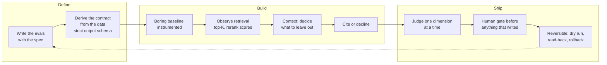

# Sayandip Bagchi

I write the specs — and I build the tooling that makes those specs cheaper to get right. Right now that means a hybrid team of people and agents, and I spend a lot of time on the agent lifecycle so the humans on the team actually get faster.

At Zeta, I run four consumer programmes as product leader, with a team of twelve: a sub-prime credit card live in operations in the UK, two credit cards in the US, one of them semi-prime and in build, and a US checking account. Two regulated markets, one team. Before Zeta: Mu Sigma, a founder stint at Parentof, Director of Product at Niyo. IIM Indore. Fourteen years: decision sciences, then edtech, then fintech.

## AI stack

                  

## Building with AI

How an agent or retrieval system goes from idea to something my team trusts.

## Worth opening

**Code** means clone it and run it. **Product definition** means the artefacts that define a product before anyone builds it. **Write-up** means an engineering account of a system that runs on internal or client data, where the architecture and the failure modes are public and the corpus and deployment are not. Every write-up says so at the top.

Roughly in the order I would want them read.

- [superset-bi-agent](https://github.com/SayandipBagchi/superset-bi-agent) · **Code.** Builds and QCs Superset dashboard suites for card programmes, deriving each engagement's stage ladder from a transition matrix on live data. It exists because the stage names in the PRD, the event names in the warehouse and the states the data actually moves through are three different things, and a dashboard built on the first two reconciles perfectly against the wrong definition.
- [cx-running-sheet](https://github.com/SayandipBagchi/cx-running-sheet) · **Code.** Weekly contact-centre insights from Amazon Connect: segments separated from conversations, themes coded from transcripts only, and unique-user figures withheld when identity coverage cannot support them. Written after a single-call pull returned the first 300 rows of a much larger window and nothing looked wrong.
- [connect-identifier](https://github.com/SayandipBagchi/connect-identifier) · **Code.** Writes a row a day saying which customer every Amazon Connect chat and call was. It exists because the programme had a Connect console login and a Superset login and no AWS IAM, and because the identifier sits on the contact record where the search API will not return it. Read-back equality is the definition of success, not the absence of an exception.
- [observability](https://github.com/SayandipBagchi/observability) · **Code.** Real-time business alerting built inside MoEngage. It turns an observability sheet into approved alerts, builds them in the browser, proves delivery, and audits for alerts that silently stopped. Ten skills, eight agents, 23 eval cases, scalable across tenants tenant. 
- [geoask-prototype](https://github.com/SayandipBagchi/geoask-prototype) · **Product definition.** A consumer product defined end to end before a line of production code: strategy memo, competitive triangulation, unit economics with the method shown for every figure, UX spec, brand book and a clickable prototype.
- [uk-compliance-knowledge-base](https://github.com/SayandipBagchi/uk-compliance-knowledge-base) · **Write-up.** Retrieval over the UK retail financial-services rulebook, with page-precise PDF citations and a rule that makes the system decline rather than paraphrase. A confident paraphrase of a rule that does not exist is worse than no answer.
- [enterprise-rag-knowledge-base](https://github.com/SayandipBagchi/enterprise-rag-knowledge-base) · **Write-up.** Retrieval question-answering over a company's internal product documentation, built end to end. The lesson I keep: write the eval set before the pipeline, not at phase four.
- [amazon-connect-flow-tools](https://github.com/SayandipBagchi/amazon-connect-flow-tools) · **Code.** Renders an Amazon Connect contact flow as a draw.io diagram, and repairs and validates an export before you import it. Python stdlib only, 35 tests. Written after a failed import at 11pm before a go-live, caused by one placeholder ARN.
- [uat-jira-automation](https://github.com/SayandipBagchi/uat-jira-automation) · **Write-up.** Filing a UAT round's findings into Jira without filing the duplicates. The matching threshold is the whole problem: a false match silently drops a real bug, and a false miss files a duplicate.
- [prd-builder](https://github.com/SayandipBagchi/prd-builder) · **Code.** A product requirement from source ticket through PRD, review, delivery tickets and test design, with a definition-of-ready gate the downstream skills obey. It exists because the expensive failure is not slow writing, it is a document that reads as finished and is not.
- [humanise-plugin](https://github.com/SayandipBagchi/humanise-plugin) · **Code.** A Claude Code plugin that rewrites AI-shaped prose back into the writer's voice with every fact, number and citation intact, working from a catalogue of 21 named patterns. It exists because the tells are easy to name and hard to see in your own draft.
- [profile-optimiser-plugin](https://github.com/SayandipBagchi/profile-optimiser-plugin) · **Code.** The humanise discipline pointed at resumes, LinkedIn profiles and READMEs: two tests per line, no invented numbers, and an output gate so the rewrite does not read as generated.
- [spa-automation-toolkit](https://github.com/SayandipBagchi/spa-automation-toolkit) · **Code.** Browser-side utilities for when the API accepts what you need and the UI will not let you do it. Built to unblock a team of about 25 to 30 analysts, PMs and UAT engineers. Zero dependencies, 22 tests, every pattern in it there because something simpler failed first.

## Elsewhere

LinkedIn: [linkedin.com/in/sayandip-bagchi-3a04aa83](https://www.linkedin.com/in/sayandip-bagchi-3a04aa83) · Email: [sayandip.bagchi@gmail.com](mailto:sayandip.bagchi@gmail.com)

If something here is useful, missing or wrong, issues and pull requests are welcome. The write-ups especially: if you have built the same thing and reached a different conclusion, I would like to hear it.
